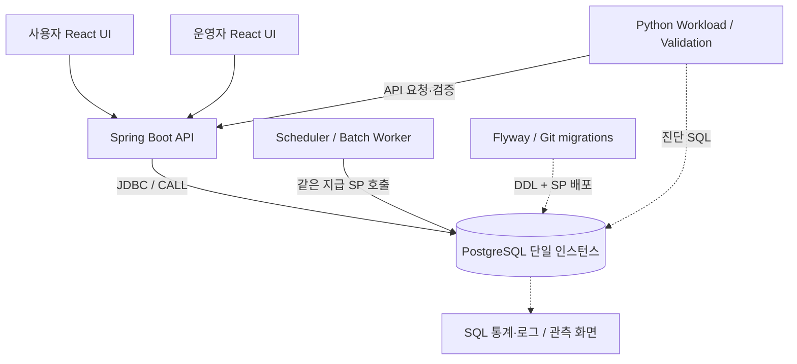
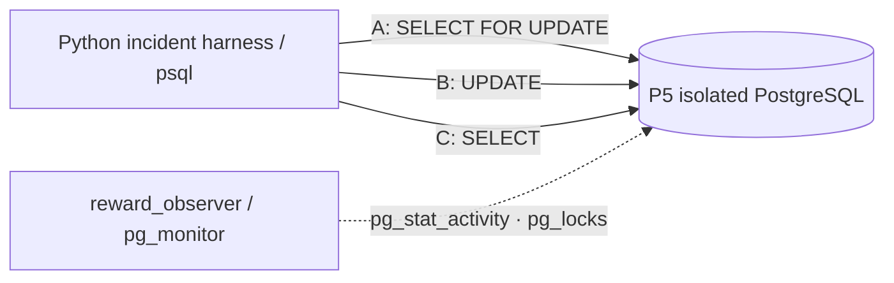
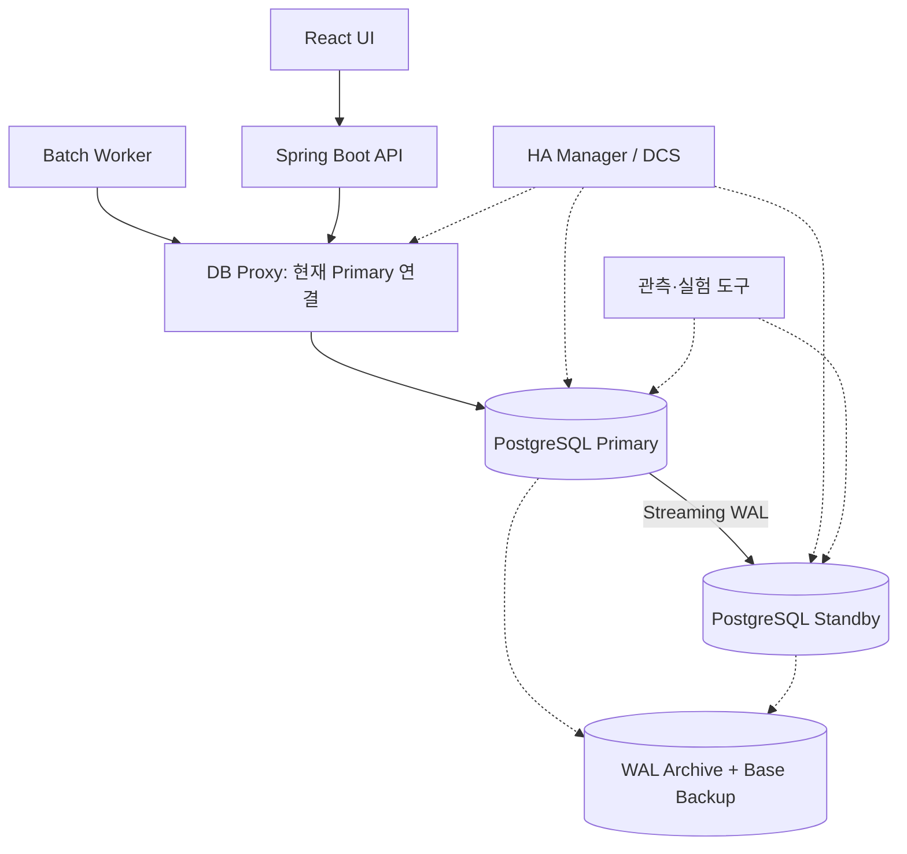
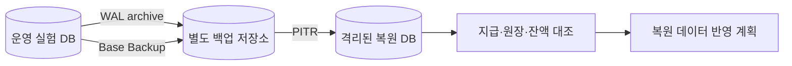
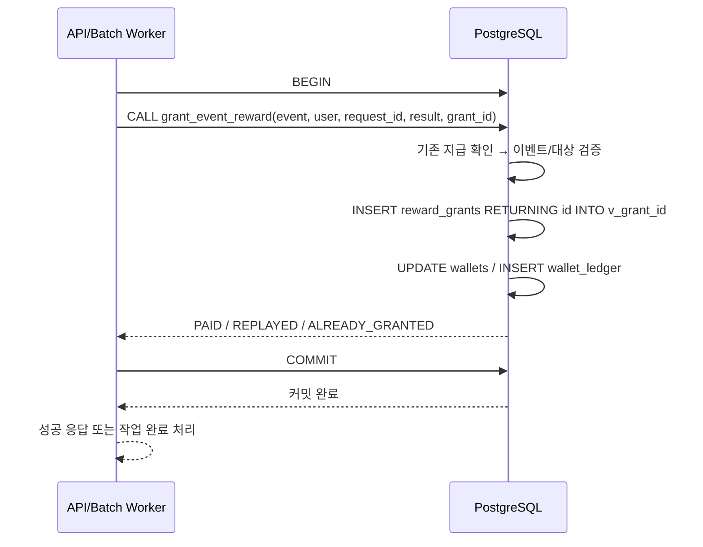

# 04. 아키텍처 문서

## 1. 설계 목표

프론트엔드에서 지급 상태와 사용자 영향을 관찰하고, DBA 측에서는 PostgreSQL의 SQL·Lock·WAL·복제·복구 지표를 추적한다. DB 운영 변경과 장애 시나리오를 **기존 도메인 기능을 유지한 채** 반복 검증할 수 있어야 한다.

## 2. P0~P2 초기 시스템

**물리 배치(로컬):** Docker Compose가 PostgreSQL과 Spring Boot를 실행. React는 개발 서버 또는 정적 빌드. Python은 호스트 또는 실험 전용 컨테이너. 초기 DB 복제 없음.

### 요청 분리

- **사용자 직접 수령:** React → API → `CALL grant_event_reward` → 트랜잭션 커밋 → 응답.
- **예약 지급:** Scheduler → 대상자 목록 조회 → 같은 SP를 사용자별 호출 → 각 트랜잭션 커밋 → 작업 로그 저장.
- **운영 변경:** Git SQL 변경 → Flyway → PostgreSQL; 서버 배포와 DB 변경의 전후 호환성 점검.
- **DB 모니터링:** 별도 읽기 계정으로 SQL 통계/서버 상태 조회; 관리자 API와 혼합하지 않음.

## 3. P5 운영 진단 구성

- P5는 `rewardp5db`와 전용 Compose volume으로 구성하고 P2~P4 앱 데이터 경로와 분리한다.
- A/B/C는 식별 가능한 `application_name`으로 연결해 Blocker와 Waiter를 구분한다.
- observer는 읽기 전용 관측 역할이며 `pg_monitor` 통계 뷰와 세션 상태를 확인한다.
- Python harness는 `docker exec`로 P5 컨테이너 안의 `psql`을 실행하고 실습 후 fixture를 원래 값으로 돌린다.

## 4. P7 HA 구성 목표

- 첫 구현은 **수동 Failover**로 DB 역할 변화·클라이언트 재연결을 확인한다.
- 자동 Failover는 Patroni/etcd 등 HA 관리 도구 도입 단계에서 별도 구성.
- **두 노드만으로 자동 Failover를 완성했다고 주장하지 않는다.** 리더 선출, DCS 가용성, 격리(fencing), 이전 Primary 복귀 절차가 필요.
- 기본 업무 조회는 Primary 사용. Standby 읽기 분산은 *복제 지연 시나리오에서 의도적으로 도입*하고 사용자 일관성 정책을 검증한다.
- 로컬 단일 호스트는 컨테이너/프로세스 장애와 네트워크 분리를 일부 재현할 수 있지만 실제 서버·AZ 장애 내성을 입증하지 않는다.

## 5. P6 복구 토폴로지

PITR은 **우선 별도 클러스터로 복원해 검사한다.** 운영 클러스터를 과거 시점으로 되돌리면 복구 시점 이후 정상 기록을 잃을 수 있으므로 자동 덮어쓰기를 설계하지 않는다.

## 6. 컴포넌트 책임

| 컴포넌트 | 하는 일 | 하지 않는 일 |
|---|---|---|
| React 사용자 UI | 보상 수령·잔액/원장 시각화 | DB에 직접 연결하지 않음 |
| React 운영자 UI | 이벤트 상태/예약 대상/작업 진행률 표시 | DBA 권한으로 위험 DDL·장애 주입하지 않음 |
| Spring Boot API | 인증 대체 테스트 사용자·요청/응답·트랜잭션 경계 | 원장 기록을 애플리케이션 여러 독립 트랜잭션으로 나누지 않음 |
| PostgreSQL SP | 이벤트 검증과 지급·원장·잔액 원자적 변경 | 자체 스케줄링·장애 감지·외부 HTTP 응답을 처리하지 않음 |
| Batch Worker | 실행 시각 판단, 대상 순회, 안정적 request_id, 실패/UNKNOWN 재확인 | WAL 로그를 해석해서 미지급자를 판단하지 않음 |
| DBA CLI/Flyway | DDL·인덱스·진단·배포 검증 | 실제 사용자 서비스 로직의 주체가 되지 않음 |
| Observability | DB/요청 지표·로그 수집 | 원인을 확인하지 않고 임의로 SQL을 변경하지 않음 |
| HA Manager/Proxy | 장애 감지, 승격 조정, 연결 전환 | 애플리케이션 지급 재처리 대상을 직접 결정하지 않음 |

## 7. P2 트랜잭션 흐름

- DB 프로시저가 오류를 던지고 트랜잭션을 종료할 수 없게 된 경우 API/Worker에서 ROLLBACK.
- 오류 처리 중 SQL 예외를 잡아 무조건 성공으로 바꾸면 안 됨.
- `RETURNING id`가 생성한 **실제 지급 ID**를 원장 외래 키로 사용한다. 하드코딩하지 않는다.
- `PAID`는 SP의 처리 결과이고 **최종 성공은 COMMIT 완료 후** 판정한다.

## 8. 의도한 장애 경계

| 장애 지점 | 데이터가 보존되는 근거 | 복구 동작 |
|---|---|---|
| API 프로세스 종료, DB 정상 | 커밋된 PostgreSQL 트랜잭션 | 동일 request_id 재호출/대조 |
| DB 프로세스 비정상 종료, 저장소 유지 | 체크포인트와 WAL에 의한 Crash Recovery | DB 정상화 후 미지급 조회 |
| Primary 물리 장애, Standby 승격 | Standby 수신·재생 WAL 수준에 의존 | RPO/RTO 계측·기존 Primary 격리 |
| 사용자의 잘못된 DELETE 커밋 | 백업과 아카이브 WAL | 별도 DB로 PITR 복원·대조 |
| Standby Replay 지연 | Primary 커밋은 유지, 읽기 일관성 지연 | 읽기 경로/복제 정책 검토 |

## 9. 계정·설정·보안

- 연결 자격증명은 `.env`/Secret에 저장; 예시 파일은 가짜 값만.
- 최소 역할: `app_rw`(지급 호출·업무 SQL), `db_migration`(DDL), `db_observer`(읽기/통계), `db_admin`(실험 관리).
- 실제 게임 사용자 인증과 분산 접근 제어는 실험 범위 밖. 로컬에서 편의용 사용자 전환을 사용하더라도 운영 환경 설계로 주장하지 않는다.
- 로그는 request_id, event_id, user_id, operation, timestamp를 기록하되 실제 개인정보·비밀번호는 제외.

## 10. 후속 CloudNativePG 실험(P9 선택)

기존 PostgreSQL을 Kubernetes + CloudNativePG 클러스터로 옮겨, 백업·복원/애플리케이션 연결 전환/데이터 정합성 및 운영 편의성을 비교한다. 동일 DBMS 환경 이관을 먼저 수행하고, MySQL→PostgreSQL과 같은 이종 DB 이관은 별도 과제로 구분한다.
