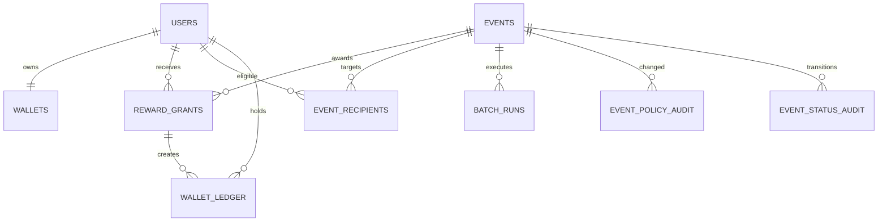

# 05. 테이블 설계서 — 기준 v1 / P3 변경안

## 1. 명명과 범위

- **이전 초안:** `reward_claims` 중심으로 사용자 직접 수령만 표현.
- **새 기준:** `reward_grants`는 지급 완료 여부를 나타내며 `CLAIM`/`BATCH` 공통으로 사용. `event_recipients`는 예약 지급의 대상 명단.
- 데이터 모델은 `MONEY`, `POINT` 두 게임 재화를 한 지갑에 저장하며 지급 원장은 재화별 개별 행으로 저장.
- 아래 DDL은 **기준 스키마 설계**다. 구현 DB에는 Flyway V1~V3를 적용했고, P2 `batch_runs` 집계 컬럼과 지급 프로시저는 V3 migration에 추가했다. 실행 결과와 migration 내용은 [구현 기록](implementation/exec.md) 및 [V3](../database/migrations/V3__reward_procedure_and_batch_runs.sql)를 참고한다.

## 2. ERD



## 3. 초기 테이블 목록

| 테이블 | PK | 중요 컬럼 | 제약/주요 용도 |
|---|---|---|---|
| `users` | id | nickname | 실험 사용자 |
| `wallets` | user_id | money_balance, point_balance | 각 잔액 >= 0, user 1:1 |
| `events` | id | status, mode, starts_at, ends_at, scheduled_at, reward_money, reward_point | 이벤트 정책 |
| `event_recipients` | (event_id,user_id) | 대상 등록시각 | 일괄 대상 명단 |
| `reward_grants` | id | event_id, user_id, request_id, money_awarded, points_awarded | 이벤트당 사용자 1회; 실제 지급 증거 |
| `wallet_ledger` | id | reward_grant_id, user_id, currency_type, amount | 지급에 따른 불변 원장 |
| `event_policy_audit` | id | event_id, 이전·변경 지급액 | 이벤트 정책 변경 이력 |
| `event_status_audit` | id | event_id, 이전·변경 상태, actor | 생성 및 OPEN/CLOSED 상태 이력 |
| `batch_runs` | id | event_id, status, started_at, finished_at | 배치 실행 관측 기록; 지급 판정 근거는 아님 |

## 4. P0/P2 기준 DDL 예시

```sql
CREATE TABLE users (
    id BIGINT PRIMARY KEY,
    nickname TEXT NOT NULL
);

CREATE TABLE wallets (
    user_id BIGINT PRIMARY KEY REFERENCES users(id),
    money_balance BIGINT NOT NULL DEFAULT 0 CHECK (money_balance >= 0),
    point_balance BIGINT NOT NULL DEFAULT 0 CHECK (point_balance >= 0)
);

CREATE TABLE events (
    id BIGINT GENERATED ALWAYS AS IDENTITY PRIMARY KEY,
    name TEXT NOT NULL,
    mode TEXT NOT NULL CHECK (mode IN ('CLAIM', 'BATCH')),
    status TEXT NOT NULL DEFAULT 'DRAFT'
        CHECK (status IN ('DRAFT', 'OPEN', 'CLOSED')),
    starts_at TIMESTAMPTZ NOT NULL,
    ends_at TIMESTAMPTZ NOT NULL,
    scheduled_at TIMESTAMPTZ,
    reward_money BIGINT NOT NULL DEFAULT 0 CHECK (reward_money >= 0),
    reward_point BIGINT NOT NULL DEFAULT 0 CHECK (reward_point >= 0),
    CHECK (starts_at < ends_at),
    CHECK (reward_money > 0 OR reward_point > 0),
    CHECK (mode = 'CLAIM' OR (scheduled_at IS NOT NULL
        AND scheduled_at >= starts_at AND scheduled_at < ends_at))
);

CREATE TABLE event_recipients (
    event_id BIGINT NOT NULL REFERENCES events(id),
    user_id BIGINT NOT NULL REFERENCES users(id),
    created_at TIMESTAMPTZ NOT NULL DEFAULT now(),
    PRIMARY KEY (event_id, user_id)
);

CREATE TABLE reward_grants (
    id BIGINT GENERATED ALWAYS AS IDENTITY PRIMARY KEY,
    event_id BIGINT NOT NULL REFERENCES events(id),
    user_id BIGINT NOT NULL REFERENCES users(id),
    request_id UUID NOT NULL UNIQUE,
    money_awarded BIGINT NOT NULL CHECK (money_awarded >= 0),
    points_awarded BIGINT NOT NULL CHECK (points_awarded >= 0),
    created_at TIMESTAMPTZ NOT NULL DEFAULT clock_timestamp(),
    UNIQUE (event_id, user_id),
    UNIQUE (id, user_id),
    CHECK (money_awarded > 0 OR points_awarded > 0)
);

CREATE TABLE wallet_ledger (
    id BIGINT GENERATED ALWAYS AS IDENTITY PRIMARY KEY,
    user_id BIGINT NOT NULL REFERENCES users(id),
    reward_grant_id BIGINT NOT NULL,
    currency_type TEXT NOT NULL CHECK (currency_type IN ('MONEY', 'POINT')),
    amount BIGINT NOT NULL CHECK (amount > 0),
    created_at TIMESTAMPTZ NOT NULL DEFAULT clock_timestamp(),
    FOREIGN KEY (reward_grant_id, user_id)
        REFERENCES reward_grants(id, user_id),
    UNIQUE (reward_grant_id, currency_type)
);

CREATE TABLE event_policy_audit (
    id BIGINT GENERATED ALWAYS AS IDENTITY PRIMARY KEY,
    event_id BIGINT NOT NULL REFERENCES events(id),
    old_money BIGINT NOT NULL,
    old_point BIGINT NOT NULL,
    new_money BIGINT NOT NULL,
    new_point BIGINT NOT NULL,
    changed_at TIMESTAMPTZ NOT NULL DEFAULT clock_timestamp()
);

CREATE TABLE event_status_audit (
    id BIGINT GENERATED ALWAYS AS IDENTITY PRIMARY KEY,
    event_id BIGINT NOT NULL REFERENCES events(id),
    previous_status TEXT CHECK (previous_status IN ('DRAFT', 'OPEN', 'CLOSED')),
    new_status TEXT NOT NULL CHECK (new_status IN ('DRAFT', 'OPEN', 'CLOSED')),
    changed_by_user_id BIGINT NOT NULL REFERENCES users(id),
    changed_at TIMESTAMPTZ NOT NULL DEFAULT clock_timestamp()
);

CREATE TABLE batch_runs (
    id BIGINT GENERATED ALWAYS AS IDENTITY PRIMARY KEY,
    event_id BIGINT NOT NULL REFERENCES events(id),
    status TEXT NOT NULL CHECK (status IN ('RUNNING', 'COMPLETED', 'FAILED')),
    started_at TIMESTAMPTZ NOT NULL DEFAULT clock_timestamp(),
    finished_at TIMESTAMPTZ,
    error_summary TEXT
);
```

## 5. 지급 SP 계약과 `RETURNING id`

- **프로시저 예시명:** `grant_event_reward(p_event_id BIGINT, p_user_id BIGINT, p_request_id UUID, p_result INOUT TEXT, p_grant_id INOUT BIGINT)`.
- **결과:** `PAID`, `REPLAYED`, `ALREADY_GRANTED`, `NOT_AVAILABLE` 등. 오류는 예외를 상위 트랜잭션에 전달.
- 사전 검증: 기존 지급 기록 확인 → 이벤트 상태·방식·실행 가능 시각 → BATCH이면 `event_recipients` 대상 존재 검증.
- 이벤트 정책은 `SELECT ... FOR SHARE`로 읽어 동시 정책 변경과 경합 시 일관된 스냅샷을 확보하도록 검증.
- 충돌방지: `UNIQUE(event_id,user_id)` + INSERT CONFLICT 처리.
- API와 Worker가 동일 SP를 호출하지만 **CLAIM/BATCH 호출 권한은 서버에서 이벤트 mode와 역할로 통제**한다.
- `READ COMMITTED` 가정. 다른 격리 수준 사용 시 충돌/재시도 케이스 다시 검증.

```sql
-- 저장 프로시저 내부 PL/pgSQL의 핵심 구간 (단독 실행용 SQL은 아님)
DECLARE
    v_grant_id BIGINT;
BEGIN
    INSERT INTO reward_grants (
        event_id, user_id, request_id, money_awarded, points_awarded
    ) VALUES (
        p_event_id, p_user_id, p_request_id, v_money, v_point
    )
    ON CONFLICT (event_id, user_id) DO NOTHING
    RETURNING id INTO v_grant_id;

    IF v_grant_id IS NULL THEN
        -- 새 SQL 문에서 기존 지급을 조회해 REPLAYED / ALREADY_GRANTED 반환
        -- 재화와 원장은 추가로 변경하지 않는다.
        RETURN;
    END IF;

    UPDATE wallets
    SET money_balance = money_balance + v_money,
        point_balance = point_balance + v_point
    WHERE user_id = p_user_id;
    IF NOT FOUND THEN
        RAISE EXCEPTION 'wallet missing';
    END IF;

    IF v_money > 0 THEN
        INSERT INTO wallet_ledger
            (user_id, currency_type, amount, reward_grant_id)
        VALUES (p_user_id, 'MONEY', v_money, v_grant_id);
    END IF;
    IF v_point > 0 THEN
        INSERT INTO wallet_ledger
            (user_id, currency_type, amount, reward_grant_id)
        VALUES (p_user_id, 'POINT', v_point, v_grant_id);
    END IF;
    p_grant_id := v_grant_id;
    p_result := 'PAID';
END;
```

위 구간의 `v_money`, `v_point`는 이미 검증한 이벤트 금액이며, 전체 SP 정의에는 이벤트 조회·기존 지급 조회·상태검사·모드검증이 추가되어야 한다. `RETURNING id INTO v_grant_id`로 얻은 ID를 실제 원장 FK에 사용한다. **해당 코드는 SP 핵심 동작을 설명하는 부분 발췌이며, 그대로 복사해 실행되는 전체 CREATE PROCEDURE가 아니다.**

### 주의할 동시성 정책

- 서로 다른 `request_id`로 같은 `(event_id,user_id)`를 지급하면 하나만 INSERT 성공. 나머지는 기존 지급 반환.
- 같은 request_id가 다른 이벤트·사용자에서 먼저 사용됐다면 별도의 UNIQUE 충돌 → 오류로 처리.
- 처음 COMMIT되지 않은 트랜잭션은 다른 요청이 완료를 기다릴 수 있음.
- `RETURNING` 결과 반환 자체는 COMMIT 성공 증거가 아님.
- 정책 변경은 이벤트 행 갱신과 충돌할 수 있으므로 락 순서 및 타임아웃 테스트 필요.

## 6. 초기 예시 데이터

```text
events
id | name                | mode  | reward_money | reward_point | status
1  | 겨울 출석           | CLAIM | 1000         | 200          | OPEN
2  | 점검 기념 일괄 지급  | BATCH | 500          | 100          | OPEN

event_recipients  (이벤트2)
(event_id,user_id): (2,101), (2,102), (2,103), (2,104) ...

wallets: (101,0,0)
```

이벤트 1을 사용자 101이 정상 수령하면:

```text
reward_grants: (grant_id=1, event_id=1, user_id=101, money=1000, point=200)
wallets: (101, 1000, 200)
wallet_ledger: (user=101, MONEY, +1000, grant=1)
               (user=101, POINT, +200, grant=1)
```

이벤트 2 지급 중 장애가 나면 `event_recipients`와 `reward_grants`를 조인하여 **실제 남은 대상자**를 산출한다.

```sql
SELECT r.user_id
FROM event_recipients AS r
LEFT JOIN reward_grants AS g
  ON g.event_id = r.event_id AND g.user_id = r.user_id
WHERE r.event_id = 2 AND g.id IS NULL
ORDER BY r.user_id;
```

## 7. P3 장애 보상 기능 추가 — 마이그레이션 설계

**기존 구조:** `wallet_ledger.reward_grant_id NOT NULL`이므로 이벤트 외 지급 출처를 표현할 수 없음.

**확장 후:**

```text
compensations(
  id, event_id, user_id, request_id, incident_reference, reason,
  operator_user_id, money_awarded, points_awarded, created_at
)
wallet_ledger.source_type: EVENT / COMPENSATION
wallet_ledger.reward_grant_id: EVENT일 때만 설정
wallet_ledger.compensation_id: COMPENSATION일 때만 설정
```

예시 DDL(적용 순서·배포 검증은 변경배포 문서 참조):

```sql
ALTER TABLE wallet_ledger
ADD COLUMN source_type TEXT NOT NULL DEFAULT 'EVENT';

ALTER TABLE wallet_ledger
ADD COLUMN compensation_id BIGINT;

ALTER TABLE wallet_ledger
ALTER COLUMN reward_grant_id DROP NOT NULL;

-- compensations 생성 후 복합 FK와 CHECK를 NOT VALID로 추가하고 별도 VALIDATE
-- source_type='EVENT'이면 reward_grant_id만 존재
-- source_type='COMPENSATION'이면 compensation_id만 존재
```

`request_id`는 동일 요청 재시도를 식별한다. 별도로 `(event_id, incident_reference, user_id)`에 UNIQUE를 두어 요청 ID가 바뀌어도 같은 장애 건·사용자에게 다시 보상하지 않게 한다. 원장 FK는 `(compensation_id,user_id)` 복합 키를 참조하므로 다른 사용자의 보상 기록을 연결할 수 없다.

`ADD COLUMN ... DEFAULT 'EVENT'`는 PostgreSQL 11 이상에서 고정 기본값의 경우 일반적으로 기존 행 전체를 UPDATE하지 않아도 된다. 그러나 `ALTER TABLE`은 필요한 잠금 획득을 위해 대기할 수 있다. **실제 Backfill 실험**은 이전 데이터를 행별로 계산해야 하는 별도 요구(예: 이력별 외부 식별자 매핑)에 대해서만 수행한다.

## 8. 실제 정합성 검사 예시

```sql
-- 중복 지급 탐지 (정상이라면 0행)
SELECT event_id, user_id, COUNT(*)
FROM reward_grants
GROUP BY event_id, user_id
HAVING COUNT(*) > 1;

-- 각 지급의 재화별 원장 합계와 지급 스냅샷 비교
SELECT g.id,
       g.money_awarded,
       g.points_awarded,
       COALESCE(SUM(l.amount) FILTER (WHERE l.currency_type='MONEY'),0) AS ledger_money,
       COALESCE(SUM(l.amount) FILTER (WHERE l.currency_type='POINT'),0) AS ledger_point
FROM reward_grants AS g
LEFT JOIN wallet_ledger AS l ON l.reward_grant_id = g.id
GROUP BY g.id, g.money_awarded, g.points_awarded
HAVING g.money_awarded <> COALESCE(SUM(l.amount) FILTER (WHERE l.currency_type='MONEY'),0)
    OR g.points_awarded <> COALESCE(SUM(l.amount) FILTER (WHERE l.currency_type='POINT'),0);
```

초기 잔액 0·지급 이외 변동 없음이라는 P2 실험 조건에서는 사용자별 원장 합계와 지갑 잔액도 대조 가능하다. 이후 정정·차감 기능을 추가하면 불변조건을 함께 수정한다.

## 9. 열려 있는 설계 판단

- 실제 PostgreSQL 실행 검증을 통해 SP 전부를 확정할 것.
- 이벤트 OPEN 중 대상 명단 변경 금지 정책 및 batch_runs 자동 복구 방식 확정.
- BATCH 지급 시 `request_id`는 `(event_id,user_id)`에서 안정적으로 파생한 UUID 또는 DB가 보관하는 영속 요청 ID를 사용.
- 대규모 데이터의 `wallet_ledger` 인덱스 및 페이징 키는 실제 실행 계획 측정 후 결정.
