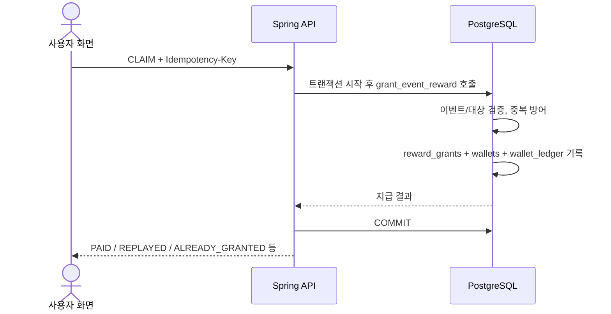
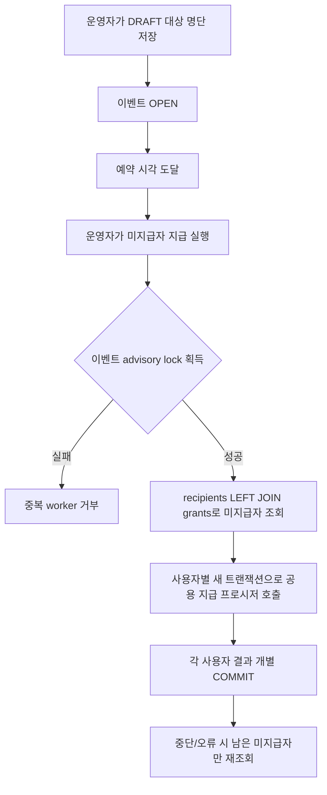

# 현재 구현 Phase 안내 — P5

> **현재 상태 (2026-11-22):** P5 전용 PostgreSQL에서 `idle in transaction`이 보유한 행 Lock과 대기 UPDATE를 재현하고, observer 진단·대기 해소·fixture 복구를 확인했다. 실행 순서와 관측값은 [P5 실행 기록](exec/p5.md)에 있다. P0~P5 변경과 결과는 [phase별 구현 기록](exec.md)을 참고한다.

## 이 프로젝트와 현재 단계

이 프로젝트는 React 화면과 Spring Boot API를 통해 게임 이벤트 보상을 PostgreSQL에 지급하는 로컬 DBA 실습 환경이다. 가상 Money/Point를 지급할 때 **grant(지급 사실), wallet(현재 잔액), ledger(잔액 변동 원장)**가 함께 맞는지, 요청이 겹치거나 작업이 중단돼도 중복·누락 없이 확인하고 재개할 수 있는지를 단계별로 확인한다.

현재 집중하는 Phase는 **P5 — 운영 진단과 Lock Wait 대응**이다. P3는 이벤트 지급과 별도의 고객지원 보상을 원장에 추가하고 schema 변경 중 기존 CLAIM을 유지했다. P4는 백만 건의 원장에서 검색 계획과 인덱스 비용을 비교했다. P5는 세션 상태와 대기 사슬을 읽고, 조치 후 업무 결과와 기준 데이터를 확인한다.

## Phase 지도

| 단계 | 하는 일 | 무엇을 확인하는가 | 현재 상태 |
|---|---|---|---|
| P0 | PostgreSQL, 스키마, Flyway, API 연결, 초기 데이터 준비 | 새 DB를 만들고 서비스가 연결되는가 | 구현 및 로컬 기동 확인 |
| P1 | 이벤트·지갑 화면, CLAIM, 운영자 상태 관리 구현 | UI/API 작업이 DB의 지급·잔액·원장으로 반영되는가 | 기능 구현. 전체 화면 Gate는 미완료 |
| P2a | `grant_event_reward` 프로시저로 CLAIM 지급 규칙 통합 | 동시 요청, 멱등 재시도, 중복 방지, 원자성 | 핵심 인수 실험 통과 |
| P2b | BATCH 대상 관리와 수동 worker 구현 | 대상별 커밋, worker 중복 방지, 장애 후 재개·대사 | 1,000명 Crash Recovery 실험 통과 |
| P3 | 이벤트 장애 CS 보상, 통합 지급 이력 검색, 온라인 schema 변경·Lock·migration 실패 복구 | 기존/구버전 CLAIM, 두 출처의 FK/대사, DDL 대기, 날짜와 cursor 경계 | 핵심 구현·실습 완료; 보상 재전송은 사용자가 직접 확인 |
| P4 | 백만 지급 원장, EXPLAIN, 부분 인덱스, 인덱스 생성 방식 비교 | 전체 검색/기간 검색 계획, WAL·공간 비용, DML 대기 | 구현·실습 완료 |
| P5 | PostgreSQL 세션·Lock 진단, incident 대응·복구 기록 | Blocker/Waiter, wait event, 트랜잭션 나이, 동시 SELECT, 복구 뒤 정합성 | Lock Wait 실습 완료 |
| P6 이후 | Backup/PITR, 복제·Failover, 운영 자동화 | 복원 결과, RPO/RTO, HA와 반복 진단 | 다음 단계 |

## P2에서 데이터가 흐르는 방식

### CLAIM — 사용자가 직접 수령 (P2a)



같은 키로 다시 보낸 요청은 기존 요청의 결과를 돌려준다. 다른 키라도 같은 사용자·이벤트에 이미 지급됐다면 다시 지급하지 않는다. 지급 기록, 잔액 변경, 원장 중 하나라도 실패하면 API 트랜잭션 전체가 롤백되어야 한다.

### BATCH — 명단 사용자에게 일괄 지급 (P2b)



명단은 DRAFT에서 교체하고 OPEN 뒤에는 동결한다. 실행 단위는 사용자별 독립 트랜잭션이다. 따라서 이미 커밋된 사용자의 지급은 뒤의 사용자 실패 때문에 취소되지 않고, 재실행은 `event_recipients LEFT JOIN reward_grants` 결과에 따라 실제로 지급되지 않은 사용자만 찾는다. `batch_runs`는 실행 상태와 통계를 관찰하기 위한 기록이고, 지급 완료 여부의 기준은 `reward_grants`다.

여기서 두 종류의 복구를 구분한다. **PostgreSQL Crash Recovery**는 WAL을 사용해 DB 안에서 커밋된 변경을 복구하고 미완료 트랜잭션을 정리한다. 이것만으로 “어떤 명단 사용자를 아직 지급해야 하는가”가 결정되지는 않는다. 그 판단은 서비스가 대상 명단과 `reward_grants`를 다시 대조하는 **업무 재처리**가 맡는다.

## 무엇을 확인할 수 있나

### P2a가 확인한 범위

- 같은 사용자·이벤트·요청 ID로 100개 병렬 요청: `PAID=1`, `REPLAYED=99`.
- 다른 요청 ID로 같은 이벤트/사용자 재요청: `ALREADY_GRANTED`.
- 다른 사용자가 같은 요청 ID 사용: HTTP 409.
- 성공한 지급 1건과 Money/Point 원장 2건, grant-원장 불일치 0건.
- 원장 INSERT를 실패시킨 뒤 트랜잭션을 롤백했을 때 지급 grant 잔존 0건, 지갑 잔액 불변.

이 결과는 100개 병렬 CLAIM 요청, 같은 요청 키 재시도, 중복 지급 방지, 원장 오류 rollback 시나리오에서 기록했다.

### P2b가 확인한 범위

- 1,000명 명단에 대한 사용자별 커밋과 분배 현황 조회.
- 같은 이벤트의 중복 worker 실행이 HTTP 409로 거부되는 동작.
- 처리 중 DB/API 강제 종료 뒤 PostgreSQL WAL REDO와 서비스 재기동.
- 재기동 후 남은 명단만 다시 실행하고 최종적으로 대상 1,000명·grant 1,000건·미지급 0명 달성.
- 최종 grant-원장 및 테스트 지갑-전체 원장 불일치가 각각 0건.

이번 실험에서 중단 직전 관찰한 grant 수는 688건이고, 종료 신호 전달 중 추가 커밋된 행까지 Crash Recovery가 반영한 뒤에는 825건이었다. 최종 대사 결과는 `1000 | 1000 | 0 | 0 | 0` (대상 | grant | 미지급 | grant-원장 불일치 | 지갑-원장 불일치)였다.

## 직접 실행하고 확인하는 순서

### 1. 로컬 서비스 열기

현재 개발 환경에서 사용하는 주소는 아래와 같다. 프런트는 5174, API는 8082, PostgreSQL은 5432이며 Compose 설정상 로컬 호스트에서만 접근 가능하다.

| 구성요소 | 주소 | 확인 방법 |
|---|---|---|
| 화면 | http://127.0.0.1:5174 | 브라우저에서 열기 |
| API | http://127.0.0.1:8082 | `/actuator/health` 호출 |
| PostgreSQL | `127.0.0.1:5432` | Compose의 `db` 서비스로 `psql` 실행 |

Docker Engine을 먼저 실행한다. 이 개발 환경의 화면 포트는 SSH 포워딩이 연결된 Colima 엔진을 사용한다. 같은 프로젝트라도 Docker 엔진이 다르면 API와 DB가 화면과 분리될 수 있으므로, 현재 관리형 환경에서는 그 엔진에서 Compose를 실행한다.

```sh
ssh -S /private/tmp/reward-lima/colima/ssh.sock -O forward \
  -L /private/tmp/reward-colima/active-docker.sock:/var/run/docker.sock localhost
cd /Users/jeonjeonghyeon/studyCollection/dbaPj
export DOCKER_HOST=unix:///private/tmp/reward-colima/active-docker.sock
docker info --format 'Docker Engine={{.ID}} Name={{.Name}}'
docker compose ps
docker compose up --build -d
curl http://127.0.0.1:8082/actuator/health
```

다른 Docker 환경에서는 프로젝트 디렉터리에서 평소처럼 `docker compose up --build -d`를 실행한다. 관리형 Colima에서는 `active-docker.sock`이 화면 포트 포워딩과 같은 Docker 엔진을 가리킨다. 다른 소켓을 선택하면 컨테이너가 정상이어도 화면과 별도 DB를 보게 될 수 있다.

응답의 상태가 `UP`인지 확인한다. 프런트 개발 서버가 꺼져 있다면 별도 터미널에서 실행한다.

```sh
cd /Users/jeonjeonghyeon/studyCollection/dbaPj/frontend
npm ci
npm run dev
```

### 2. 화면에서 CLAIM 확인

1. 화면 상단에서 사용자(101~103)를 선택하고 `이벤트` 화면을 연다.
2. `CLAIM` 모드이며 `OPEN` 상태이고 현재 시각이 이벤트 기간에 포함된 항목을 고른다.
3. 수령 버튼을 누르고 성공/이미 수령/수령 불가 상태를 확인한다.
4. `내 지갑`에서 Money와 Point 잔액 및 최근 원장을 확인한다.
5. 재시도·중복 방어는 CLAIM API에 구현돼 있다. 요청 결과와 `내 지갑` 잔액·원장을 직접 확인하고, 초기화 후 다시 수령해 반복할 수 있다.

운영자 화면에서는 `운영자` 역할을 선택해 이벤트를 DRAFT로 만들고 OPEN/CLOSED 전이를 확인할 수 있다. 상단 역할 전환은 API 요청의 `X-Demo-Role` 헤더를 설정하는 개발용 기능이다.

#### 프런트에서 지갑 초기화하기

사용자 한 명만 초기화하려면 상단에서 대상 사용자를 고르고 `내 지갑`으로 이동한다. `내 지갑 초기화`를 누른 뒤 확인 영역에서 실행한다. 해당 사용자의 Money·Point 잔액을 0으로 만들고, 재수령을 막는 기존 `reward_grants`와 연결된 `wallet_ledger`도 함께 지운다. 다른 사용자의 데이터에는 영향이 없다.

모든 사용자를 초기화하려면 상단 역할을 `운영자`로 바꾸고 `운영 관리`로 이동한다. `전체 유저 초기화`를 누르고 확인 문구 `전체 초기화`를 입력해 실행한다. 데모 사용자 101~103뿐 아니라 DB에 등록된 P2 실험 사용자까지 대상이다. 모든 사용자의 wallet/grant/ledger를 초기화하고 사용자·이벤트·BATCH 대상 명단·배치 실행 이력은 보존한다.

두 동작 모두 잔액만 수정하지 않는다. grant/원장 정합성을 먼저 확인하고 문제가 있으면 삭제 없이 중단한다. BATCH 워커가 실행 중이어도 reset을 거부하고 작업이 끝난 뒤 다시 시도하게 한다. 실제 수령과 멱등성 요청은 사용자가 이벤트 화면이나 API에서 직접 실행한다. 이 API는 `APP_DEMO_WALLET_RESET_ENABLED=true`인 로컬 Compose에서만 등록된다.

### 3. 화면에서 BATCH 확인

1. 운영자 모드에서 `BATCH` 이벤트를 DRAFT로 등록한다.
2. 대상 ID를 쉼표 또는 줄바꿈으로 입력해 명단을 저장한다. 명단을 저장하면 기존 명단 전체가 교체된다.
3. 대상 사용자가 존재하는지 확인한 뒤 이벤트를 OPEN한다. OPEN 이후에는 명단을 수정할 수 없다.
4. 예약 시각이 지난 뒤 `미지급자 지급`을 누른다. 이 프로젝트에는 자동 scheduler가 없으므로 수동 시작이 필요하다.
5. 대상·지급·미지급 수와 최근 실행 상태를 확인한다. 다시 실행해도 이미 grant가 존재하는 사용자는 지급 대상에 들어가지 않는다.

### 4. API에서 직접 확인

API 기본 사용자 ID는 101이다. CLAIM은 UUID 형식의 `Idempotency-Key`가 필요하다. 운영자 API에는 데모 역할 헤더 `X-Demo-Role: ADMIN`을 전달한다.

| 메서드와 경로 | 확인하는 동작 |
|---|---|
| `GET /api/events` | 사용자에게 보이는 이벤트와 수령 가능 여부 |
| `POST /api/events/{eventId}/claims` | CLAIM 지급. 같은 `Idempotency-Key`를 재사용해 replay를 확인 |
| `GET /api/me/wallet`, `GET /api/me/ledger` | 사용자 잔액과 원장 |
| `PUT /api/admin/events/{eventId}/recipients` | DRAFT BATCH 대상 명단 전체 교체 |
| `POST /api/admin/events/{eventId}/open`, `/close` | 이벤트 상태 전이 |
| `GET /api/admin/events/{eventId}/distribution` | 대상·지급·미지급·최근 worker 실행 조회 |
| `POST /api/admin/events/{eventId}/run` | 미지급 BATCH worker 수동 시작 |
| `POST /api/me/wallet/reset` | 선택한 현재 데모 사용자 1명의 잔액·grant·원장 초기화 |
| `POST /api/admin/wallets/reset-all` | 운영자 데모 역할로 DB의 모든 사용자 잔액·grant·원장 초기화 |

예를 들어 이벤트 목록과 지갑은 다음처럼 확인한다.

```sh
curl http://127.0.0.1:8082/api/events
curl -H 'X-User-Id: 101' http://127.0.0.1:8082/api/me/wallet
```

목록에서 CLAIM 이벤트 ID를 확인한 뒤, 새 UUID를 만들어 한 번 지급한다. **같은 요청을 재시도할 때는 동일한 UUID를 다시 사용한다.**

```sh
CLAIM_IDEMPOTENCY_KEY="$(uuidgen | tr '[:upper:]' '[:lower:]')"
curl -X POST http://127.0.0.1:8082/api/events/CLAIM_EVENT_ID/claims \
  -H 'X-User-Id: 101' \
  -H "Idempotency-Key: $CLAIM_IDEMPOTENCY_KEY"
```

요청할 때 `CLAIM_EVENT_ID`를 숫자 이벤트 ID로 바꾸고, 새 시도라면 UUID도 새로 만든다. 사용자와 운영자 구분은 `X-User-Id`, `X-Demo-Role` 헤더로 전달한다.

#### 멱등성 직접 확인

위 단계의 첫 호출은 `PAID`여야 한다. 아래처럼 같은 UUID로 다시 보내면 `REPLAYED`가 반환되고, UUID를 바꾸어도 같은 이벤트·사용자 조합은 `ALREADY_GRANTED`가 된다. 지갑을 요청 전후 조회하면 보상은 한 번만 증가해야 한다.

```sh
# 같은 터미널에서 앞 단계의 CLAIM_IDEMPOTENCY_KEY 값을 유지한다.
curl -X POST http://127.0.0.1:8082/api/events/CLAIM_EVENT_ID/claims \
  -H 'X-User-Id: 101' \
  -H "Idempotency-Key: $CLAIM_IDEMPOTENCY_KEY"

# 위 요청을 같은 헤더와 본문으로 다시 실행한다. 새 UUID를 쓰면 replay가 아니다.
curl -X POST http://127.0.0.1:8082/api/events/CLAIM_EVENT_ID/claims \
  -H 'X-User-Id: 101' \
  -H "Idempotency-Key: $CLAIM_IDEMPOTENCY_KEY"
```

다른 요청 ID도 확인하려면 아래처럼 새 UUID를 써서 한 번 더 요청한다. 결과가 `ALREADY_GRANTED`여야 한다.

```sh
ANOTHER_IDEMPOTENCY_KEY="$(uuidgen | tr '[:upper:]' '[:lower:]')"
curl -X POST http://127.0.0.1:8082/api/events/CLAIM_EVENT_ID/claims -H 'X-User-Id: 101' -H "Idempotency-Key: $ANOTHER_IDEMPOTENCY_KEY"
```

#### 사용자 한 명을 SQL에서 초기화하기

화면 대신 SQL을 쓸 때는 다음 로컬 전용 스크립트에 대상 ID를 전달한다. 현재 사용자의 모든 CLAIM/BATCH grant와 원장을 지운 뒤 Money·Point를 0으로 설정한다. grant snapshot 및 wallet과 ledger 합계가 다르면 변경 없이 중단한다.

```sh
export DOCKER_HOST=unix:///private/tmp/reward-colima/active-docker.sock
docker compose exec -T db psql -U reward_bootstrap -d rewarddb \
  -v ON_ERROR_STOP=1 -v user_id=101 -f - \
  < experiments/sql/reset_local_user_wallet.sql
```

이는 사용자 한 명의 전체 지급 이력을 지우므로 로컬 실습 DB에서만 실행한다. 전체 사용자 초기화는 `운영 관리` UI에서 확인 문구를 입력해 실행한다.

전체 데이터베이스를 처음부터 만들 때만 다음 명령을 쓴다. 이 방법은 아래 지갑 reset과 달리 이벤트와 실험 데이터까지 전부 삭제한다.

```sh
export DOCKER_HOST=unix:///private/tmp/reward-colima/active-docker.sock
docker compose down -v
docker compose up --build -d
```

### 5. P2 수용 실험 실행

실험 스크립트와 자세한 옵션은 [experiments/README.md](../../experiments/README.md)에 있다. Python 표준 라이브러리만 사용한다.

```sh
cd /Users/jeonjeonghyeon/studyCollection/dbaPj
export DOCKER_HOST=unix:///private/tmp/reward-colima/active-docker.sock
python3 experiments/p2_acceptance.py p2a
python3 experiments/p2_acceptance.py p2b
```

Crash Recovery까지 실습할 때만 다음 옵션을 별도 실행한다.

```sh
python3 experiments/p2_acceptance.py p2b --crash-after-first-page
```

> **주의:** crash 옵션은 이 프로젝트 Compose의 DB와 API 컨테이너에 SIGKILL을 보내고 같은 named volume로 재시작한다. 응답 중인 API 요청이 끊기며 로컬 실험 데이터가 추가된다. 운영 DB나 다른 프로젝트에서 실행하지 않는다. 명령을 실행한 뒤에도 볼륨을 자동으로 지우지 않는다.

### 6. SQL로 저장 결과 대사

실험 스크립트가 결과를 출력하지만 DB에 저장된 행을 직접 확인하려면 아래 SQL 파일을 실행한다. `event_id`는 해당 acceptance 실행 출력에서 확인한 이벤트 번호로 바꾼다. 현재 보존된 P2b 이벤트는 73이다.

```sh
export DOCKER_HOST=unix:///private/tmp/reward-colima/active-docker.sock
docker compose exec -T db psql -U reward_bootstrap -d rewarddb -v event_id=73 < experiments/sql/verify_p2b_event.sql
```

P2a 이벤트에는 `experiments/sql/verify_p2a_event.sql`을 사용한다. 결과 열의 의미는 다음과 같다.

| SQL 결과 | 의미 | P2 완료 결과 |
|---|---|---:|
| `recipients` | BATCH 대상 명단 행 수 | 1,000 |
| `grants` | 실제 지급 완료 수 | 1,000 |
| `pending` | 명단에는 있지만 grant가 없는 사용자 수 | 0 |
| `grant_ledger_mismatches` | 지급 snapshot과 재화별 ledger 합이 다른 grant 수 | 0 |
| `wallet_ledger_mismatches` | 테스트 사용자 wallet 잔액과 전체 ledger 합이 다른 사용자 수 | 0 |

P2a SQL은 grant 수, 원장 행 수, grant-원장 불일치 수를 확인한다. 성공 결과는 `1 | 2 | 0`이다. 일부러 오류를 내고 롤백하는 절차는 [rollback_after_ledger_failure.sql](../../experiments/sql/rollback_after_ledger_failure.sql)에 있으며 acceptance 스크립트가 실행한다.

## P3 — 장애 보상과 온라인 DB 변경

P3 장애 실습은 P3 전용 DB의 새 이벤트에서 **reward_grants INSERT 실패를 주입**하고, wallet·grant·ledger 상태를 확인한 뒤 이벤트를 닫고 CS 보상을 지급하는 순서로 진행합니다.

장애 보상은 `compensations`에 관련 이벤트, 장애 식별자, 대상 사용자, 요청 ID, 사유, 운영자, Money/Point snapshot을 남깁니다. 지갑과 원장 두 재화 행을 같은 트랜잭션에서 반영합니다. 원장 `source_type`과 FK/CHECK가 `EVENT` 또는 `COMPENSATION` 중 하나만 허용합니다. 같은 event·incident reference·user 조합은 요청 ID가 달라도 한 번만 저장됩니다.

### 별도 P3 화면과 DB 열기

P3 전용 DB는 `rewardp3db`와 `reward_p3_pgdata`를 사용합니다. P2의 5432/8082/5174와 데이터를 공유하지 않습니다. P3 compose는 로컬 데모 지갑 reset과 P3 보상 API를 켜며, 두 API 포트는 loopback에만 공개됩니다.

```sh
cd /Users/jeonjeonghyeon/studyCollection/dbaPj
export DOCKER_HOST=unix:///private/tmp/reward-colima/active-docker.sock
P3_FLYWAY_TARGET=11 APP_P3_COMPENSATION_ENABLED=true APP_DEMO_WALLET_RESET_ENABLED=true \
  docker compose -p reward-p3 -f compose.p3.yaml up --build -d
```

다른 터미널에서 P3 UI를 엽니다.

```sh
cd /Users/jeonjeonghyeon/studyCollection/dbaPj/frontend
VITE_DEV_PORT=5175 \
VITE_API_PROXY_TARGET=http://127.0.0.1:8182 \
VITE_P3_COMPENSATION_ENABLED=true \
npm run dev -- --host 127.0.0.1
```

브라우저에서 `http://127.0.0.1:5175`를 열고 ADMIN 역할을 고릅니다. P3 API는 `http://127.0.0.1:8182`, DB는 `127.0.0.1:55432`입니다. 종료할 때는 P3 프로젝트만 `docker compose -p reward-p3 -f compose.p3.yaml down`으로 내립니다. `-v`를 붙이지 않으면 P3 실습 볼륨도 보존됩니다. 이번 실행은 reset 경로가 POST로 등록된 것을 GET의 HTTP 405로 확인했으며, 실습 증거를 유지하기 위해 reset 요청은 보내지 않았습니다.

### 통제된 CLAIM 장애 → CS 보상 순서

1. 운영 화면에서 지금 열려 있는 기간의 CLAIM 이벤트를 새로 만들고 OPEN합니다. 기존 seed 이벤트 대신 별도 이벤트를 쓰면 어떤 행이 실습 데이터인지 구분하기 쉽습니다.
2. 화면에서 해당 이벤트 ID를 확인한 뒤 그 ID에만 실패 trigger를 설치합니다.

   ```sh
   P3_EVENT_ID=이벤트_ID
   cat experiments/sql/p3_install_claim_failure.sql | \
     docker exec -i reward-p3-db-1 psql -U reward_migration -d rewardp3db \
       -v p3_event_id="$P3_EVENT_ID"
   ```

3. USER 역할로 한 번 CLAIM합니다. 예상 결과는 DB 오류 응답입니다. 같은 사용자·이벤트의 wallet, grant, ledger가 그대로인지 `experiments/sql/verify_p3_compensation.sql`로 읽기 전용 확인합니다.
4. trigger와 fixture를 제거하고 ADMIN에서 실습 이벤트를 CLOSED로 전환합니다. 장애가 끝난 뒤 normal CLAIM을 열어 둔 채 별도 보상을 더하지 않도록 닫습니다.

   ```sh
   cat experiments/sql/p3_remove_claim_failure.sql | \
     docker exec -i reward-p3-db-1 psql -U reward_migration -d rewardp3db
   ```

5. 운영 화면의 `장애 보상 지급`에서 영향 사용자, 이벤트, `OUTAGE-P3-001` 같은 장애 식별자, 사유와 금액을 입력해 지급합니다. 지갑 화면에는 원장 출처와 사유가 표시되고, ADMIN의 지급 이력 검색에서 사용자·기간·출처로 찾을 수 있습니다.
6. 다시 검증 SQL을 실행합니다. 보상 snapshot = compensation ledger 합계, wallet = 사용자 전체 ledger 합계여야 하며 위반/불일치 쿼리는 0행이어야 합니다.

실습 결과와 사용한 event ID·API 응답은 [P3 실행 기록](exec/p3.md)에 순서대로 남깁니다.

### DDL Lock 관측

P3 DB에서 세 개 세션을 사용합니다. A는 다음처럼 SELECT 트랜잭션을 열어 둡니다. B는 `reward_migration`으로 ALTER를 시도하고, C는 같은 테이블을 조회합니다.

```sql
-- 세션 A: SELECT가 끝나도 COMMIT 전까지 AccessShareLock 유지
BEGIN;
SELECT count(*) FROM reward.wallet_ledger;
SELECT pg_sleep(15);
COMMIT;

-- 세션 B: 별도 연결에서 실행해 DDL lock 대기를 제한
SET lock_timeout = '4s';
ALTER TABLE reward.wallet_ledger ADD COLUMN p3_lock_probe INTEGER;

-- 세션 C: B가 lock queue 앞에서 대기할 때 뒤따른 요청을 관찰
SELECT count(*) FROM reward.wallet_ledger;
```

다른 연결에서 `pg_stat_activity`와 `pg_blocking_pids(pid)`를 조회해 blocker와 대기자를 기록합니다. `lock_timeout`으로 B가 취소된 뒤 C가 진행되는지, A가 종료된 뒤 B를 재시도했을 때 lock 대기와 DDL 실행 시간이 각각 얼마인지 확인합니다. 확인 후 `p3_lock_probe` 열을 제거합니다. DDL queue 때문에 이후 SELECT도 대기할 수 있고, 이는 DBA 개념 자료의 [온라인 스키마 변경](../../dba/chapters/16-online-schema-deployment.md)에서 설명합니다.

## 현재 Phase P4 — 대량 지급 이력 검색과 인덱스 튜닝

P4는 관리자 지급 이력 화면이 사용하는 `/api/admin/payouts` 쿼리를 백만 건의 wallet ledger에서 측정합니다. fixture는 EVENT 990,000행과 COMPENSATION 10,000행으로 구성해 보상 출처가 전체의 1%입니다. 사용자 wallet 합과 ledger 합이 맞는지 먼저 확인하고, 전역 최신순 검색과 기간 검색에 다른 인덱스가 필요한지 실행계획으로 살펴봅니다.

### P4 전용 서버 열기

P4는 `rewardp4db`와 `reward_p4_pgdata`를 사용합니다. P2와 P3 데이터·포트와 분리되어 있습니다.

```sh
cd /Users/jeonjeonghyeon/studyCollection/dbaPj
ssh -S /private/tmp/reward-lima/colima/ssh.sock -O forward \
  -L 127.0.0.1:8282:127.0.0.1:8282 localhost
export DOCKER_HOST=unix:///private/tmp/reward-colima/active-docker.sock
docker compose -p reward-p4 -f compose.p4.yaml up --build -d
```

P4 화면은 별도 터미널에서 실행합니다.

```sh
cd /Users/jeonjeonghyeon/studyCollection/dbaPj/frontend
VITE_DEV_PORT=5176 \
VITE_API_PROXY_TARGET=http://127.0.0.1:8282 \
VITE_P3_COMPENSATION_ENABLED=true \
npm run dev -- --host 127.0.0.1
```

열 주소는 화면 `http://127.0.0.1:5176`, API `http://127.0.0.1:8282`, DB `127.0.0.1:55433`입니다. P4 API는 Flyway V11 schema로 실행합니다.

### fixture와 실행계획 확인

빈 P4 volume을 처음 만들었을 때만 1백만 원장 fixture를 넣습니다. seed SQL은 `rewardp4db`와 빈 `wallet_ledger`를 확인한 뒤 시작합니다.

```sh
docker exec -i reward-p4-db-1 psql -X -v ON_ERROR_STOP=1 \
  -U reward_migration -d rewardp4db < experiments/sql/p4_seed_ledger.sql
docker exec -i reward-p4-db-1 psql -X -v ON_ERROR_STOP=1 \
  -U reward_migration -d rewardp4db < experiments/sql/p4_explain_payout_search.sql
```

기준 실행계획에서는 전역 검색이 primary key 역방향 스캔을 하며 필터에서 9,851행을 버립니다. 날짜 검색은 백만 행 테이블을 병렬 순차 스캔합니다. 후보 부분 인덱스 두 개를 만든 뒤 같은 쿼리를 실행하면 최신순 커서는 보상 전용 id 인덱스, 날짜 구간은 created_at 인덱스를 선택합니다.

```sh
docker exec -i reward-p4-db-1 psql -X -v ON_ERROR_STOP=1 \
  -U reward_migration -d rewardp4db < experiments/sql/p4_candidate_indexes.sql
docker exec -i reward-p4-db-1 psql -X -v ON_ERROR_STOP=1 \
  -U reward_migration -d rewardp4db < experiments/sql/p4_explain_payout_search.sql
```

후보를 정리하고 최종 두 인덱스를 동시성 생성으로 반영할 때는 다음 순서로 실행합니다. `CREATE INDEX CONCURRENTLY` 문장은 명시적인 `BEGIN/COMMIT` 안에 넣지 않습니다.

```sh
docker exec -i reward-p4-db-1 psql -X -v ON_ERROR_STOP=1 \
  -U reward_migration -d rewardp4db < experiments/sql/p4_drop_candidate_indexes.sql
docker exec -i reward-p4-db-1 psql -X -v ON_ERROR_STOP=1 \
  -U reward_migration -d rewardp4db < experiments/sql/p4_create_indexes_concurrently.sql
```

전체 출처 인덱스 `(source_type, id DESC)` 후보는 약 30MB였고, 보상 cursor/date 부분 인덱스는 각각 약 672KB였습니다. 보상 출처가 1%인 이 fixture에서는 부분 인덱스가 두 검색에 필요한 행만 색인합니다.

### 조회와 쓰기 비용 확인

```sh
docker exec -i reward-p4-db-1 psql -X -v ON_ERROR_STOP=1 \
  -U reward_migration -d rewardp4db < experiments/sql/p4_write_cost.sql
python3 experiments/p4_index_build_demo.py
```

`p4_write_cost.sql`은 같은 50,000행을 PK-only 임시 테이블과 부분 인덱스 2개가 있는 임시 테이블에 넣고 WAL과 크기를 출력한 뒤 테이블을 지웁니다. 인덱스 방식 스크립트는 장기 쓰기 트랜잭션, DDL, 대기 중인 UPDATE를 관찰하고 마지막에 probe 인덱스를 제거합니다.

실행계획과 측정 결과는 [P4 실행 기록](exec/p4.md)에서 확인합니다. UI에서 `운영 관리 → 지급 이력 검색`을 열면 source, 사용자, 기간, beforeId 조건으로 같은 API를 직접 조회할 수 있습니다.

## 현재 Phase P5 — 운영 진단과 Lock Wait 대응

P5에서는 앱 화면을 추가하는 대신 DB 안의 장애 징후를 해석합니다. 세션 A가 행 Lock을 보유한 채 트랜잭션을 열어 두고, 세션 B의 UPDATE가 대기합니다. observer는 두 세션의 PID·상태·SQL·wait event를 연결합니다. 세션 C의 SELECT도 실행해 어떤 요청이 기다리고 어떤 요청이 이전 committed 값을 읽는지 확인합니다.

### P5 전용 서버와 fixture 준비

P5는 `rewardp5db`, `reward_p5_pgdata`, PostgreSQL 17.12와 Docker Engine loopback의 55434 포트를 사용합니다. 기존 P2~P4 컨테이너·볼륨과 분리됩니다. 관리형 Colima에서는 호스트 `psql` 대신 같은 Docker Engine의 `docker exec`로 실습 명령을 실행합니다.

```sh
cd /Users/jeonjeonghyeon/studyCollection/dbaPj
export DOCKER_HOST=unix:///private/tmp/reward-colima/active-docker.sock
docker -H "$DOCKER_HOST" compose -p reward-p5 -f compose.p5.yaml up -d
docker -H "$DOCKER_HOST" compose -p reward-p5 -f compose.p5.yaml ps

docker -H "$DOCKER_HOST" exec -i reward-p5-db-1 psql -X -v ON_ERROR_STOP=1 \
  -U reward_bootstrap -d rewardp5db < experiments/sql/p5_prepare_lock_lab.sql
```

`p5_prepare_lock_lab.sql`은 DB명이 `rewardp5db`가 아니면 중단합니다. 첫 Compose 초기화 시 observer에 `pg_monitor`를 부여하며, 관측 계정은 fixture를 SELECT할 수 있지만 UPDATE 권한은 없습니다.

### P5 incident 실행

```sh
python3 experiments/p5_lock_incident.py
docker -H "$DOCKER_HOST" exec -i reward-p5-db-1 psql -X -v ON_ERROR_STOP=1 \
  -U reward_observer -d rewardp5db < experiments/sql/p5_observe_lock_wait.sql
```

1. A가 `BEGIN` 뒤 `SELECT ... FOR UPDATE`로 행을 잠그고 `idle in transaction` 상태가 됩니다.
2. B가 같은 행 UPDATE를 요청해 `Lock/transactionid`를 기다립니다.
3. `pg_blocking_pids()`로 B→A blocker 관계와 A/B SQL을 대조합니다.
4. C의 SELECT가 기다리는 동안 `balance=100`을 읽는지 확인합니다.
5. A를 COMMIT하고 B 완료 및 단일 잔액 증가를 확인합니다. harness는 실습 후 기준값 100을 복구합니다.

수동 진단이 필요하면 관측 SQL을 다른 연결에서 실행합니다. 실행 전 가설과 실제 관측은 [P5 실행 기록](exec/p5.md)에서 구분합니다. 사건 타임라인, 선택한 조치, 사후 데이터 대사와 재발 방지 제안도 같은 기록에 있습니다.

## 핵심 개념과 참고 자료

| 개념 | 이 프로젝트에서의 뜻 | 로컬 자료 |
|---|---|---|
| 원자성(Atomicity) | 지급 grant·지갑 잔액·재화 원장이 함께 커밋되거나 함께 롤백됨 | [트랜잭션과 정확성](../../dba/foundations/04-transactions-and-correctness.md) |
| 멱등성(Idempotency) | 같은 요청을 다시 보내도 지급이 중복되지 않음 | [트랜잭션과 정확성](../../dba/foundations/04-transactions-and-correctness.md) |
| UNIQUE와 경합 | 애플리케이션 확인만 믿지 않고 DB 제약으로 사용자별 중복 grant를 막음 | [버전과 트랜잭션](../../dba/concepts/04-versions-and-transactions.md) |
| Advisory lock | 같은 이벤트의 batch worker가 동시에 실행되지 않도록 작업 단위 잠금을 둠 | 구현 주석과 [exec.md](exec.md) 참조 |
| Lock wait 진단 | `wait_event_type`, blocker PID, SQL, 트랜잭션 상태를 연결해 요청 대기 원인을 좁힘 | [P5 실습](exec/p5.md), [U15](../../dba/chapters/15-monitoring-troubleshooting.md) |
| WAL REDO | DB crash 후 커밋된 페이지 변경을 복구해 PostgreSQL 데이터 상태를 회복 | [Crash Recovery](../../dba/chapters/01-crash-recovery.md) |
| 업무 재처리 | DB 복구와 별도로 대상 명단과 지급 사실을 대조해 미지급자를 재실행 | [P2 실험 README](../../experiments/README.md) |

프로젝트의 `dba/`는 질문에 맞는 근거 문서를 찾아 읽는 **로컬 지식 자료 모음**으로 활용한다. 현재 서비스에 문서를 색인하거나 검색하는 RAG/vector DB 파이프라인이 동작한다는 뜻은 아니다.

## 남은 구현 항목과 환경 정보

- 전체 TC-001~016을 완료하지 않았다. UI에서의 모든 오류 상태, COMMIT 뒤 응답 유실, 이벤트 상태 전이와 지급의 정확한 Lock 경합은 남아 있다.
- BATCH worker는 관리자 수동 호출이며 자동 예약 실행, 비동기 job queue, 장시간 polling은 없다. 1회 실행 대상 수는 최대 1,000명이다.
- 브라우저 역할과 사용자 ID는 개발용 `X-Demo-Role`, `X-User-Id` 헤더로 전달되며 인증 연동은 구현 범위에 포함하지 않았다.
- P2 acceptance 기록 당시에는 사용자 910001~911000, BATCH 이벤트 5·38·73 등 실험 데이터가 든 volume을 사용했고, 사용자 101에는 P2a 결과 Money +14, Point +6이 있었다. 이는 과거 실행 기록이다.
- 과거 실행 기록의 `default/docker.sock`은 화면 포트 포워딩과 분리된 Docker 엔진이었다. 현재 화면은 SSH 포워딩된 Colima 엔진의 DB를 사용하며 기존 P2 사용자/이벤트 데이터가 들어 있다. 관리형 환경에서 초기화·crash 실험을 하기 전에 `active-docker.sock`이 가리키는 엔진을 사용한다.
- `docker compose down`은 대상 엔진의 컨테이너만 내리고 데이터를 보존한다. `docker compose down -v`는 그 엔진의 볼륨과 로컬 DB 데이터를 삭제하므로 의도적으로 DB 전체를 재생성할 때만 사용한다.

다음으로는 [11_구현Phase.md](../11_구현Phase.md)의 미완료 Gate와 [10_검증및실험계획.md](../10_검증및실험계획.md)의 미실행 사례를 순서대로 확인한다.
