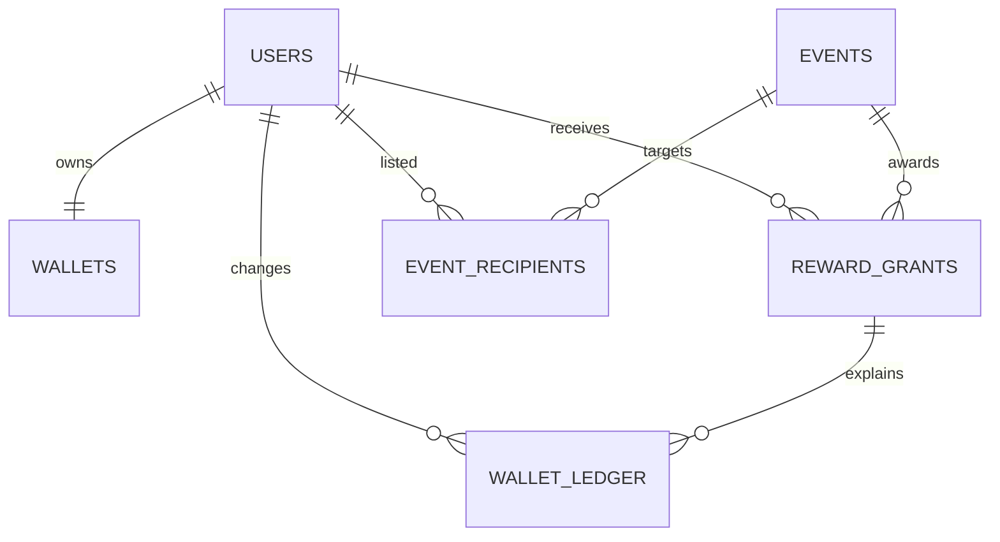

# P0–P1 | 게임 보상 DB의 기반 설계와 데이터 모델

## 한 줄 요약

게임 이벤트 보상 서비스의 기본 관계형 모델과 실행 환경을 구성하고, 지급 결과가 DB 테이블에 어떻게 표현되는지 설계했습니다.

## 문제와 설계

이벤트 보상은 지급 사실, 현재 잔액, 잔액 변동 내역이 서로 맞아야 합니다. 그래서 세 데이터를 역할별 테이블로 분리했습니다.

- `reward_grants`는 사용자·이벤트별 실제 지급 사실과 지급 시점의 금액 snapshot을 저장합니다.
- `wallets`는 현재 Money/Point 잔액을 저장합니다.
- `wallet_ledger`는 각 재화의 잔액 변동 근거를 지급 건과 연결합니다.
- `event_recipients`는 BATCH 대상 명단을 나타내며, 지급 완료 기록을 대신하지 않습니다.
- PK/FK/UNIQUE/CHECK 제약과 인덱스로 관계와 주요 무결성 규칙을 DB에 둡니다.

## 구현 내용

- PostgreSQL 17.12, Docker Compose, Spring Boot API, React/Vite 화면으로 로컬 재현 환경을 구성했습니다.
- Flyway V1에 도메인 테이블·제약·인덱스를, V2에 데모 데이터와 초기 이벤트를 추가했습니다.
- `reward_app`, `reward_migration`, `reward_observer`를 나눠 API DML, schema 변경, 관측 권한을 분리했습니다.
- 애플리케이션 연결과 Flyway 연결을 분리했습니다. API 런타임 계정에는 DDL 권한을 주지 않았습니다.
- 이벤트 상태 감사 이력을 지급 정책 감사 이력과 별도 테이블로 관리했습니다.

## 확인한 결과

- PostgreSQL 컨테이너 healthy, Flyway V1/V2 적용, API health `UP`을 확인했습니다.
- 프런트 HTTP 200과 이벤트 목록 API 응답을 확인했습니다.
- CLAIM 이후 지급·지갑·원장 정합성은 P2 acceptance와 P3 호환 실행에서 이어서 확인했습니다.

## DBA 직무와 연결되는 판단

잔액만 저장하면 지급 근거와 변동 경로를 확인하기 어렵습니다. 지급 snapshot과 원장을 별도로 두고 FK 및 UNIQUE를 통해 연결하면 운영자가 지급 한 건의 원인과 재화별 반영 결과를 SQL로 대조할 수 있습니다. 역할 분리와 migration 버전 관리는 이후 schema 변경을 검토하고 재현하는 기반이 됩니다.

## 근거 자료

- [P0–P1 구현 기록](../../implementation/exec/p0-p1.md)
- [초기 schema migration V1](../../../database/migrations/V1__create_reward_schema.sql)
- [역할 생성 스크립트](../../../database/bootstrap/10-create-roles.sh)
- [프로젝트 설계서](../../03_프로젝트설계서.md)
